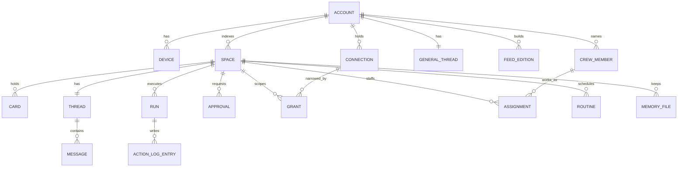

# Client API (draft 1, 2026-11-12)

Status: **to reconcile with `design/ui-direction.md`**, which did not exist when this was written. Screen needs were derived from `design/prototype-v3/` (Spaces with Now, Next and Later bands and rings; Story; Today deck and day line; Capture; Templates; Approve with press and hold) and architecture section 4h (feed, chief, threads, generative layout).

Nothing here is code. Shapes are given as field lists. Every body is JSON validated by a strict schema in `@later/protocol` (unknown keys rejected, protocol text rules apply). Card, source and tool shapes are those in `docs/protocol.md`.

## 1. Transport

| Channel | Used for | Notes |
|---|---|---|
| HTTPS, JSON | Every read and every command | Same origin as the web app, which the backend serves. One base path: `/v1` |
| Account socket `GET /v1/ws?ticket=` | Change events for everything outside an open Space | One per device. Hibernates when idle. Server to client only, apart from `hello`, `ack` and `ping` |
| Space socket `GET /v1/spaces/{id}/ws?ticket=` | Token streaming and live run status while a Space, story or thread is open | Opened on entering, closed on leaving. Goes straight to the Space object so streams are not relayed |
| Web push | Approvals, returns from Later, budget and health alerts | Payload is a type and an id only; the client fetches the content. No card text in push |
| `GET /v1/sync?cursor=` | Catch-up after sleep, and the fallback when sockets are blocked | Same events as the sockets |

Commands never travel over a socket. HTTP gives idempotency keys, status codes and retries for free, and keeps the consent path in one place.

## 2. Authentication

### 2.1 Pairing

| Step | Call | Auth | Request | Response |
|---|---|---|---|---|
| First device | `POST /v1/pair/claim` | Bootstrap code from the installer's QR (one use, hash held as a Worker secret) | `code`, `publicKey` (P-256, JWK), `deviceName`, `platform` | `deviceId`, `accountId`, `protocol`, `serverTime` |
| Add a device | `POST /v1/pair/new` | Session + device confirmation | — | `code` (128-bit, 5 minutes, one use), `qrPayload` (`later://pair?u=…&c=…`), `expiresAt` |
| New device claims | `POST /v1/pair/claim` | The code | as above | as above |
| List, revoke | `GET /v1/devices`, `DELETE /v1/devices/{id}` | Session; revoke needs a confirmation | — | devices with `name`, `platform`, `lastSeenAt`, `isThisDevice` |
| Lost every device | Re-run the installer's `pair --reset` | Cloudflare account ownership | — | New bootstrap code; all devices revoked |

The private key is generated on the device with WebCrypto as non-extractable and never leaves it.

### 2.2 Sessions

`POST /v1/session/challenge` (`deviceId`) returns a `challenge` valid 60 seconds. `POST /v1/session` (`deviceId`, `challenge`, `signature`) returns a bearer `token` valid 15 minutes, bound to the device. The Worker verifies tokens itself (HMAC with a Worker secret) so an unauthenticated request never wakes a Durable Object. Sockets use a 30-second single-use `ticket` from `POST /v1/ws-ticket`, since browsers cannot set headers on a socket.

### 2.3 Device confirmations

Any call marked **C** below carries a `confirmation`: `argsHash`, `deviceId`, `nonce` (random, 128-bit), `confirmedAt`, `signature` (device key over the canonical JSON of `purpose`, `argsHash`, `nonce`, `confirmedAt`). The Worker verifies the signature; core verifies the rest (known device, unused nonce, at most 120 seconds old, hash equal to the request's). A confirmation is created only by the fixed consent control (press and hold) and is never stored for later use, so **C** calls cannot be made offline.

`purpose` is one of `send`, `approve`, `pair`, `revoke-device`, `widen-permission`, `install-template`, `delete-space`, `disconnect`, `resume-after-halt`, `apply-update`, `raise-cap`.

## 3. Conventions

| Topic | Rule |
|---|---|
| Versioning | Path version `/v1`. `GET /v1/bootstrap` returns `protocol` and `minClient`. The web app is served by the backend, so it always matches; installed native clients below `minClient` get `426 upgrade-required` |
| Ids | Protocol id rules. Client-created objects carry a client id (`clientMutationId`, `clientMessageId`, `clientCaptureId`) |
| Idempotency | Every `POST`, `PATCH`, `PUT`, `DELETE` takes an `Idempotency-Key` header; the first response is replayed for 24 hours |
| Time | ISO 8601 UTC with `Z`. The client sends its IANA time zone once, in settings |
| Money | Integer micro-USD; display currency is a client concern |
| Pagination | `?limit=` (default 30, maximum 100) and an opaque `?cursor=`; responses carry `nextCursor` or null. Ordering is fixed per collection and stated below |
| Concurrency | Mutable resources carry `rev`. A write may send `ifRev`; mismatch returns `409 stale` with the current resource |
| Events | Every event has `seq` (per scope, strictly increasing), `at`, `scope` (`account` or `space:{id}`), `type`, `data`, and `causedBy` when it results from a client mutation |
| Strings | Plain text. Clients render as text and never fetch a URL from a card on their own (protocol client rules) |

### Error model

Errors are `{ error: { code, message, retryable, detail? } }` with the HTTP status. `message` is for logs; clients map `code` to their own copy.

| Status | Codes |
|---|---|
| 400 | `invalid-request` (with `issues[]` of `path`, `code`), `unsupported-action` |
| 401 | `no-session`, `session-expired`, `bad-signature` |
| 403 | `device-revoked`, `confirmation-required`, `confirmation-invalid` (with `reason`: `stale`, `reused`, `hash-mismatch`, `unknown-device`), `policy-denied` (with the gate's `reason` code) |
| 404 | `not-found` |
| 409 | `stale`, `already-decided`, `approval-not-pending`, `recipient-check-required`, `run-in-progress` |
| 410 | `expired` (approval, pairing code, undo window) |
| 422 | `card-invalid`, `manifest-invalid` (with issues) |
| 423 | `halted` (kill switch on), `space-paused`, `budget-paused` |
| 426 | `upgrade-required` |
| 429 | `rate-limited` (with `retryAfterMs`), `cap-reached` (with the cap's name) |
| 502 | `provider-error`, `connector-error` (with `connectionId`, `needsReauth`) |
| 503 | `platform-limit` (the daily free-plan allowance is nearly spent; with `resetsAt`), `updating` |

## 4. Resources

## 5. Endpoints

**C** = needs a device confirmation. "202" = accepted; the result arrives as events.

### 5.1 Start-up and sync

| Call | Returns |
|---|---|
| `GET /v1/bootstrap` | `account` (id, name, time zone, `halted`), `protocol`, `minClient`, `settings`, `spaces[]` (tile summaries), `crew[]`, `threads[]` (summaries), `budget` (account ledger summary, platform meter), `connections[]` (health only), `pending` (approvals, outbox, unread), `onboarding` (step), `cursor`, `serverTime` |
| `GET /v1/sync?cursor=` | `events[]`, `cursor`, or `reset: true` when the cursor is too old (client refetches bootstrap) |
| `POST /v1/ws-ticket` | `ticket`, `expiresAt` |
| `PATCH /v1/account/settings` | The settings. Fields: `timeZone`, `activeHours`, `deckTime`, `feedTime`, `sendDelaySeconds`, `locale`, `notifications` (per type). Changes that widen permissions need **C** |
| `POST /v1/halt` (`on`) | `halted`. Turning it **on** needs only a session. Turning it off needs **C** |
| `POST /v1/push/subscriptions`, `DELETE /v1/push/subscriptions/{id}` | Stores or removes a Web Push subscription for this device |
| `GET /v1/selftest`, `POST /v1/selftest/run` | Per check: `id` (`provider`, `mail-in`, `mail-out`, `calendar`, `push`, `storage`), `status`, `detail`, `checkedAt` |

### 5.2 Views (what a screen shows)

| Call | Returns |
|---|---|
| `GET /v1/views/home` | View for the Spaces screen: sections `now`, `next`, `later`, `rings` |
| `GET /v1/views/today` | Sections `deck`, `dayline`, `feed` (a teaser; the full edition is its own view) |
| `GET /v1/views/space/{spaceId}?lens=stack\|board\|timeline\|list` | The Space in one lens |
| `GET /v1/views/story/{spaceId}` | The ordered story cards for a ring |
| `GET /v1/views/feed/{editionId\|current}` | The edition |
| `GET /v1/views/thread/{threadId}` | Latest page of messages plus suggestions |

Every view response is a `ViewSpec` (plan section 4) with `included`: the cards, snippets, runs and messages its items refer to, so one request paints a screen. `?ifRev=` returns `304` when unchanged.

### 5.3 Spaces

| Call | Request | Returns / notes |
|---|---|---|
| `GET /v1/spaces` | — | Tiles: `id`, `name`, `kind`, `emblem`, `color`, `status` (the status card data: `line`, `asOf`, `health`, `progress`, `nextDate`), `needsYou` count, `focus`, `state` (`active`, `paused`, `archived`), `crew[]`, `rev`. Ordered by need, stable within a group |
| `POST /v1/spaces` | `name`, `kind`, `emblem`, `color` | The Space. Created with no grants and no routines |
| `GET /v1/spaces/{id}` | — | Tile plus `routines[]`, `grants[]`, `assignments[]`, `budget`, `policy`, `thread` summary |
| `PATCH /v1/spaces/{id}` | `name`, `emblem`, `color`, `focus`, `state` | The Space |
| `DELETE /v1/spaces/{id}` **C** | — | 202. Deletes the Space's storage; see plan section 8 |
| `GET /v1/spaces/{id}/cards` | `state`, `type`, `lens`, `cursor` | Cards, newest first, or lens order |
| `GET /v1/spaces/{id}/activity` | `cursor`, `runId?` | Action log entries: `seq`, `at`, `runId`, `agent`, `tool`, `argsPreview`, `decision`, `reason`, `approvalId?`, `deviceId?`, `result`, `undo?` |
| `GET /v1/spaces/{id}/memory`, `GET\|PUT\|DELETE /v1/spaces/{id}/memory/{path}` | `content`, `ifRev` | Files with `trust`, `private`, `rev`, `updatedBy`. User edits set `trust: user`. `GET …/history` lists versions |
| `GET /v1/spaces/{id}/routines`, `PATCH …/routines/{rid}` | `enabled`, `schedule` | Enabling a routine whose agent holds irreversible or open-egress tools needs **C** (`widen-permission`) and returns the permission summary first when called with `?preview=1` |
| `POST /v1/spaces/{id}/routines/{rid}/run` | — | 202 `runId` |
| `GET\|PUT /v1/spaces/{id}/grants` | `connectionId`, `scopes[]`, `filters` (for mail: senders, labels, date floor) | Widening needs **C**; narrowing does not |
| `GET\|PUT /v1/spaces/{id}/policy` | `alwaysAllow[]`, `egressDomains[]`, `caps`, `protectedSenders[]` | Widening needs **C**. Never writable by an agent |
| `GET\|PUT /v1/spaces/{id}/budget` | `capMicroUsd`, `perRunMicroUsd` | Ledger summary: `capMicroUsd`, `spentMicroUsd`, `reservedMicroUsd`, `status`, `cycleEnd`, `isEstimate: true`. Raising needs **C** |
| `PUT /v1/spaces/{id}/assignments` | `crewId`, `role`, `tools[]`, `tier` | See flow 12. Adding tools needs **C** |
| `POST /v1/spaces/{id}/export` | `kind`: `data` or `template` | 202 `exportId`; `GET /v1/exports/{id}` returns status and a short-lived download path |

### 5.4 Cards

| Call | Request | Returns / notes |
|---|---|---|
| `GET /v1/cards/{id}` | — | The card, `rev`, `actions[]` (from `actionsFor`, with resolved effects), `undo?` |
| `POST /v1/cards/{id}/actions` | `action`, `params?`, `clientMutationId`, `ifRev?`, `confirmation?` | `card`, `undo?` (`token`, `until`), `created[]` (for example the draft a `reply` produced), `runId?`, `outboxId?`. `local` actions return at once. `irreversible` actions need **C** and return `403 confirmation-required` with the `argsHash` and `argsPreview` to show if it is missing |
| `POST /v1/cards/actions` | `items[]` of `cardId`, `action`, `params?` (maximum 100), `clientMutationId` | Per-item results. `local` actions only; this is how a stack is ignored or snoozed in one gesture |
| `POST /v1/cards/{id}/undo` | `token` | The restored card. `410 expired` after `until` |
| `PATCH /v1/cards/{id}/draft` | `to`, `cc`, `subject`, `body`, `ifRev` | The draft with a new `rev`; recipient origins recomputed by the host; any recipient confirmation is cleared |
| `POST /v1/cards/{id}/move` | `spaceId` | The card in its new Space; undo token |

Action parameters: `snooze` takes `until` or `wake` (`time`, or `event` such as `reply-received`); `reply` takes `intent?`; `mute` takes `scope` (`sender`, `thread`); `nudge` takes nothing; `confirm-recipient` takes the `recipientSetHash` the user saw.

### 5.5 Approvals and the outbox

| Call | Request | Returns / notes |
|---|---|---|
| `GET /v1/approvals?status=pending` | — | Approval cards across Spaces, oldest first |
| `GET /v1/approvals/{id}` | — | `approvalId`, `spaceId`, `tool`, `tier`, `risk`, `argsHash`, `argsPreview[]`, `recipient?`, `reason`, `expiresAt`, `provenance`, `bulk?` (`count`, `rule[]`, `sample[]`, `protected[]`, `recovery`), `status` |
| `POST /v1/approvals/{id}/grant` **C** | `confirmation` (purpose `approve`, hash equal to the approval's) | `status`, `outboxId?` or `result` |
| `POST /v1/approvals/{id}/deny` | `reason?` | `status: denied` |
| `GET /v1/outbox` | — | Items waiting to leave: `id`, `tool`, `argsPreview`, `releaseAt`, `cardId` |
| `POST /v1/outbox/{id}/cancel` | — | The item, cancelled; the draft returns to the drafts queue. `410` once released |

### 5.6 Threads, messages and runs

| Call | Request | Returns / notes |
|---|---|---|
| `GET /v1/threads` | — | `general` plus one per Space: `id`, `spaceId?`, `lastMessage`, `unread`, `activeRunId?` |
| `GET /v1/threads/{id}/messages` | `cursor`, `aroundCardId?` | Messages, newest first |
| `POST /v1/threads/{id}/messages` | `text`, `clientMessageId`, `context?` (`cardId`), `captureId?`, `tier?` | 202 `messageId`, `runId`, and for the general thread `routedTo?` once known (by event) |
| `GET /v1/runs/{id}` | — | `id`, `spaceId`, `agent`, `trigger`, `status` (`queued`, `running`, `waiting-approval`, `interrupted`, `done`, `failed`, `cancelled`), `phase`, `startedAt`, `spentMicroUsd`, `taint` (`ingestedUntrusted`, `touchedPrivate`), `model` (provider, id, tier) |
| `GET /v1/runs?spaceId=&status=` | — | Runs, newest first |
| `POST /v1/runs/{id}/cancel`, `POST /v1/runs/{id}/resume` | — | The run |

A message is `id`, `threadId`, `role` (`user`, `agent`, `system`), `author` (crew id for agents), `at`, `blocks[]`, `runId?`, `status` (`streaming`, `complete`, `interrupted`). Block kinds: `text`; `card-ref` (`cardId`); `run-status` (`runId`); `choice` (`options[]` of `id`, `label`; choosing one posts a user message); `approval-ref` (`approvalId`, always rendered as the fixed approval control); `routed` (`spaceId`, `crewId`, shown in the general thread).

### 5.7 Capture

| Call | Request | Returns / notes |
|---|---|---|
| `POST /v1/captures` | `clientCaptureId`, `kind` (`text`, `voice`, `share`), `text?`, `transcript?`, `recordedAt`, `spaceHint?`, `needsTranscription?` | 202 `captureId`, `runId` |
| `PUT /v1/captures/{id}/audio` | Audio bytes | Only when the device could not transcribe. Streamed to speech recognition in the user's account and not stored |
| `GET /v1/captures/{id}` | — | `raw`, `clean`, `proposals[]` (`cardDraft`, `spaceId`, `confidence`), `status` |
| `POST /v1/captures/{id}/confirm` | `accept[]`, `moves[]` (`proposalId`, `spaceId`), `discard[]` | Created `filed` and `task` cards |

### 5.8 Feed

| Call | Request | Returns / notes |
|---|---|---|
| `GET /v1/feed/editions?cursor=` | — | Editions: `id`, `builtAt`, `count`, `readCount` |
| `POST /v1/feed/snippets/{id}/actions` | `action`: `save` (with `spaceId?`), `more`, `less`, `dismiss`, `mute-source` | The snippet; `save` returns the created card |
| `GET\|PUT /v1/feed/interests` | `topics[]`, `sources[]` (newsletter senders, feed addresses), `maxItems`, `budgetMicroUsd` | The interests |

### 5.9 Crew

| Call | Request | Returns / notes |
|---|---|---|
| `GET /v1/crew` | — | Chief and members: `id`, `name`, `form` (which mascot shape), `voice` (short persona text, user editable), `defaultTier`, `assignments[]`, `status` (`idle`, `working`, `waiting`, `paused`) |
| `POST /v1/crew`, `PATCH /v1/crew/{id}` | `name`, `form`, `voice`, `defaultTier` | The member |

### 5.10 Connections

| Call | Request | Returns / notes |
|---|---|---|
| `GET /v1/connectors` | — | The catalogue: `id`, `name`, `methods[]` (each with `kind`, `whoSeesData`, `steps[]`, `limits`), `tools[]` with tier and flags, `status` (`available`, `soon`, `via-email`) |
| `GET /v1/connections` | — | `id`, `connector`, `method`, `label`, `health` (`ok`, `degraded`, `reauth-required`, `failed`), `lastOkAt`, `grantedTo[]` |
| `POST /v1/connections` | `connector`, `method`, and either `credentials` (sent once, never returned) or `start: "oauth"` | The connection, or `authorizeUrl` to open |
| `POST /v1/connections/{id}/test`, `…/reauth` | — | Health, or `authorizeUrl` |
| `DELETE /v1/connections/{id}` **C** | — | Removes the credential and every grant that used it |

`GET /oauth/callback/{connectionId}` is the redirect target for the user's own OAuth clients; it completes the exchange and returns the app.

### 5.11 Templates

| Call | Request | Returns / notes |
|---|---|---|
| `GET /v1/templates/gallery` | — | Entries fetched by the backend from the published gallery index |
| `POST /v1/templates/inspect` | `url` or `manifest` | `inspectId`, `manifest`, `issues[]`, `permissions` (`summarizePermissions`), `estimateMicroUsd` (monthly range), `connectorsMissing[]` |
| `POST /v1/templates/install` **C** | `inspectId`, `spaceName`, `grants[]`, `budget` | `spaceId`; routines paused |

### 5.12 Models and budget

| Call | Request | Returns / notes |
|---|---|---|
| `GET /v1/models/providers` | — | Providers with `id`, `type`, `label`, `capabilities`, `models[]` (id, tier suitability, `untrustedContent` rating, priced or not), `health`. Keys are never returned |
| `POST /v1/models/providers` **C**, `DELETE …/{id}` **C** | `type`, `baseUrl?`, `key`, `label` | The provider |
| `POST /v1/models/providers/{id}/test` | — | A one-token call's result and our metering check |
| `GET\|PUT /v1/models/routing` | The routing table (plan section 5) | Changing a tier to a model rated below `evaluated` returns a warning the client must show |
| `GET /v1/budget` | — | Account ledger, per-Space ledgers, per-tier and per-provider spend this cycle, the platform meter (`durationPct`, `rowsWrittenPct`, `resetsAt`, `degraded[]`) |
| `PUT /v1/budget/account` (raise needs **C**) | `capMicroUsd`, `cycleDay` | The ledger |

### 5.13 Update and onboarding

| Call | Request | Returns / notes |
|---|---|---|
| `GET /v1/update` | — | `current`, `available?` (`version`, `notes`, `signatureOk`, `schemaChanges`) |
| `POST /v1/update/apply` **C** | `version` | 202; clients receive `503 updating` briefly, then reconnect |
| `GET /v1/onboarding` | — | `step`, `done[]`, `blocked?` (with the failing self-test) |
| `POST /v1/onboarding/ingest` | `budgetMicroUsd`, `lookbackDays` | 202; progress by events |
| `POST /v1/onboarding/proposals/{id}` | `accept` or `dismiss` | Creates the Space or enables the routine (enabling needs **C** when it widens permissions) |

## 6. Events

| Type | Data | Scope |
|---|---|---|
| `card.created`, `card.updated`, `card.removed` | The card and `rev`, or id | Space; mirrored to account when it changes Today or a tile |
| `view.patch` | `surface`, `rev`, `baseRev`, `ops[]` (plan section 4) | Either |
| `space.updated` | Tile | Account |
| `run.started`, `run.phase`, `run.finished` | `runId`, `agent`, `phase` (a fixed vocabulary: `reading`, `searching`, `drafting`, `filing`, `waiting`), `progress?` (`done`, `total`), `status` | Space; `run.started` and `run.finished` mirrored |
| `message.created`, `message.delta`, `message.completed` | `messageId`, `blockIndex`, `text` (appended), or the message | Space socket only for deltas |
| `approval.requested`, `approval.resolved` | The approval summary | Both |
| `outbox.queued`, `outbox.released`, `outbox.cancelled` | The item | Both |
| `budget.changed` | Ledger summary and the ledger event (`warned`, `paused`, `resumed`, `rolled-over`) | Both |
| `platform.meter` | The platform meter | Account |
| `connection.health` | `connectionId`, `health` | Account |
| `crew.status` | `crewId`, `status`, `spaceId?` | Account |
| `capture.progress`, `onboarding.progress` | Stage and counts | Account |
| `halt.changed`, `update.available`, `sync.reset` | — | Account |

Delivery is at least once and ordered within a scope. Clients drop events with a `seq` they have seen, and call `sync` if they see a gap.

## 7. Optimistic actions and undo

| Effect of the action | Client behaviour | Server behaviour |
|---|---|---|
| `none`, `local` | Apply at once; show the inline undo row; send with `clientMutationId` | Applies, returns an undo token (valid until the next action on that card or 24 hours), emits the event with `causedBy` so the client reconciles instead of animating twice |
| `reversible` (for example `fyi.revert`) | Show pending; do not animate completion until the response | Runs through the gate; may return an approval |
| `irreversible` | Never optimistic. The hold control produces the confirmation; the client shows the queued state only after the response | Authorises, consumes the nonce, places the call in the outbox, returns `outboxId` and `releaseAt` |

Undo for a local action restores the card's previous state. Undo for a queued send is `outbox cancel`. After release there is no undo and the client says so.

## 8. Offline

| Works offline | How | Does not work offline |
|---|---|---|
| Reading anything already fetched | Local store keyed by id and `rev` | Send, approve, pair, install, any **C** call |
| Local card actions | Queued in an outbox on the device with their `clientMutationId`; replayed in order on reconnect; a `409` drops the action and shows the server's state | Chat with agents |
| Capture (typed, spoken, shared) | Stored on the device with `clientCaptureId` and the on-device transcript; uploaded on reconnect | Server-side transcription |
| Editing a draft | Sent with `ifRev`; on conflict the user's text wins and is saved as a new revision | — |

## 9. To reconcile with the UI direction

1. The exact sections each screen needs, and whether Today's feed is inline or its own screen.
2. Whether Now, Next and Later are views over cards and runs (assumed here) or need their own stored items.
3. The mascot states the client wants (`crew.status` vocabulary and `run.phase` vocabulary).
4. Whether threads need rich text beyond plain paragraphs.
5. Payment approvals shown in the prototype: no endpoint exists here because no payment tool is specified.
