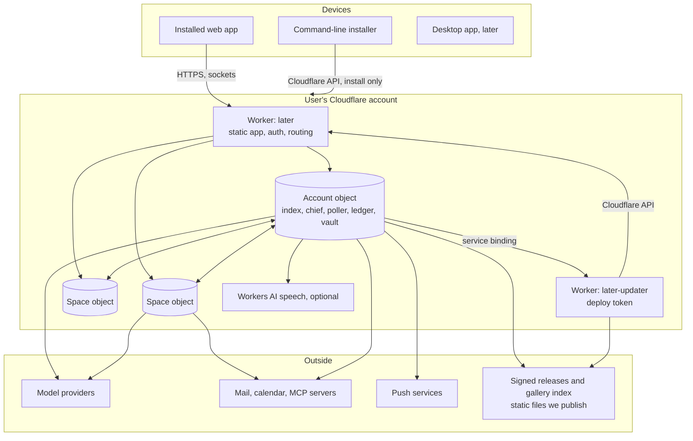

# Later — Backend Plan

Status: draft 1, 2026-11-12. Owner: backend and platform lead. **Planning only: no code exists for anything below except M0 (`packages/protocol`, `packages/core`).**

Supporting files in this folder:

| File | Holds |
|---|---|
| `flows.md` | The sixteen end-to-end flows, step by step |
| `client-api.md` | Every endpoint, event, error and the offline rules. **To reconcile with `design/ui-direction.md`**, which did not exist when this was written |
| `research/providers.md` | Provider API comparison and what was verified |
| `research/connectors.md` | Connector catalogue with sources |
| `research/guardrails-threat-model.md` | Threat model, action inventory, caps, red-team layers |
| `research/free-plan-budget.md` | Runtime and money arithmetic |

Evidence tags, as in `docs/architecture.md`: **[V]** read on an official page (through a summarising fetcher, so recheck before hard-coding), **[S]** secondary, **[?]** unconfirmed, **[J]** judgment, **[R]** already recorded in this repository. Research was done by the lead directly; no sub-agents were available in this session.

---

## 0. Summary

**The system in ten lines**

1. Two Workers in the user's Cloudflare account: `later` (web app, API, all agent work) and `later-updater` (holds the deploy token, applies signed releases, nothing else).
2. One **Account** object per install: devices, sessions, the cross-Space index that builds Today, the mail poller, the chief, the account ledger, credentials, the kill switch.
3. One **Space** object per Space: cards, memory, thread, runs, approvals, outbox, action log, Space ledger, connector grants, crew assignments.
4. All state is SQLite inside those objects. No queue, database or bucket is required on the default path.
5. Clients speak HTTPS for every read and command, plus two sockets for change events and token streams. Devices hold their own keys; consent is a signed, single-use confirmation bound to the exact arguments.
6. Every effect passes through one executor that calls the M0 gate first and writes the action log after. The model is treated as untrusted in all of it.
7. Models sit behind one provider interface with capability flags, per-model price rows and a tier routing table. Switching provider is a configuration change.
8. Connectors are connections (a credential, account level) narrowed by grants (per Space). MCP servers are connectors whose risk flags come from a profile we review, not from the server.
9. The backend describes screens as validated view data (sections, items, hints). Clients own layout and motion. Consent screens are fixed.
10. Everything is metered twice: money against the ledger, and the free-plan allowance against a platform meter that degrades work in a fixed order.

**Three decisions that matter most**

| Decision | Rejected alternative | Why |
|---|---|---|
| The chief is a router and index reader with **no connector grants**; it forwards the user's words unchanged to a Space, where a crew instance does the work | A chief agent with tools that acts across Spaces | Anything the chief reads is tainted and private. With tools it would be the bridge that Space isolation exists to prevent (section 1.4) |
| Approved actions are **executed by the host from the stored call**; the run that asked does not stay suspended and the model is not consulted again | Suspend the run until the user answers, then resume the model | No long-lived suspended state, no second chance for the model to alter the call, no cost on resume. The cost is that multi-step plans continue as a new run |
| **No permanent-delete operation exists anywhere**; removal means the provider's bin, always asks, and bulk actions bind to a frozen list of ids | Classify delete as `irreversible` and rely on approval | An approval a tired user holds through must not be able to destroy anything for good (section 6) |

**What breaks first:** Durable Object duration on the free plan, modelled at 13% to 74% of the daily allowance (section 9). **What costs most:** chat and work-tier routines, about 80% of provider spend.

**Disagreements with the architect's positions:** none with the principles. Five refinements are argued in section 11.3, the main ones being the chief's limits, a separate updater Worker, and removing `mail.delete`.

---

## 1. System map

### 1.1 Components

| Component | Owns | Does not do |
|---|---|---|
| **Worker `later`** | Static web app; session and signature verification; rate limits; routing to objects; one cron trigger that wakes the Account object if its alarm chain ever breaks | No model calls, no parsing, no storage (10 ms CPU on Free [V]) |
| **Account object** (one) | Devices, nonces, settings; Space directory and tiles; Today index, deck, feed editions; mail poller and ingest runs; calendar cache; the chief and the general thread; captures; account ledger; platform meter; connections (encrypted credentials); provider configuration; push subscriptions; `halted`; update state | Never executes a write tool on a connector |
| **Space object** (one per Space) | Cards; memory and people notes; the Space thread; runs and checkpoints; approvals; outbox; action log; Space ledger; grants; policy (allowlist, caps, protected senders); assignments and routines | Never reads another Space; holds no credentials (it asks the Account object for a short-lived use of one, scoped by its grant) |
| **Worker `later-updater`** | The deploy token; signature check; script upload; post-update self-test | Has no route from the internet and no access to user data |
| **Storage** | SQLite in each object (5 GB total on Free [V]) | No D1, KV, R2 or Queues on the default path. R2 (attachments, exports kept server-side) and Queues are optional later |
| **Scheduling** | Object alarms for everything; one cron trigger as a watchdog | No heartbeat polling with a model call (D7) |
| **Clients** | Web app first; desktop later for install and the `local` runner; installer CLI | Clients hold no provider keys and no connector credentials |

Why credentials live in the Account object and not in each Space: one mailbox serves many Spaces, re-authentication happens once, and a Space can then be deleted or exported without touching secrets. The Space sends the Account object a request naming its grant; the Account object checks the grant and performs the connector call, so a Space cannot exceed its scope even through a bug in its own code.

### 1.2 Trust boundaries

| # | Boundary | What crosses | Control |
|---|---|---|---|
| B1 | Device to Worker | Commands, confirmations | Device keys, 15-minute sessions, signed single-use confirmations, rate limits; every route authenticated (D24) |
| B2 | Runtime to model provider | Prompts out; text and tool calls in | Model output is data: schema-validated, never executed, never markup. Provider-executed tools off for private runs |
| B3 | Runtime to connector | Credentials out; external content in | Content marked `external`; credentials decrypted only in the Account object for one call |
| B4 | Space to Space | Nothing by default | Separate objects and storage; the chief's limits; grants |
| B5 | `later` to `later-updater` | A version and a confirmation | Deploy token exists only in the updater; signature checked on both sides |
| B6 | Third-party templates and MCP servers | Manifests, tool lists, tool results | Declarative manifests; reviewed tool profiles; pinned tool-list hash; results are untrusted content |
| B7 | Us to the install | Signed releases, gallery index | Signature against a pinned key; user approval; we are never on the request path (D1) |
| B8 | The Cloudflare account itself | Everything | Out of our control: whoever holds the account holds the data. Stated to the user |

B5 is enforced by the platform (separate scripts, separate secrets). B4 is enforced by object separation plus our code. Inside one script every class can read every secret binding, so the separation of credentials from agent code within `later` is by code structure and tests, not by the platform. That is acceptable while no model-written code runs anywhere; it must be revisited before any sandbox runner ships.

### 1.3 Run classes

| Class | Runs in | Tools | Used for |
|---|---|---|---|
| **ingest** | Account | None. Structured output only | Mail triage, onboarding summary, deck brief, newsletter snippets, capture extraction, chief routing |
| **public** | Account or Space | Web search and fetch; no private reads | Feed interests, research |
| **work** | Space | The assignment's tools, through the gate | Chat, drafts, routines |
| **index** | Account | Read-only index queries | Chief answering across Spaces |

An ingest run cannot act, so reading every sender's mail in one call is safe. Its output is still untrusted and is treated so downstream.

### 1.4 Chief and crew: testing the architect's mapping

Starting position: the chief is one orchestrating agent per user; crew members are configurations instantiated inside Spaces.

| Test | Finding |
|---|---|
| Isolation | Fails if the chief has tools. Card titles and status lines are model-written from untrusted mail, so the chief's context is tainted and private the moment it looks at the index. A chief that could then instruct a Space agent would carry an injected instruction from Space A to Space B's connectors |
| Cost | Passes. Routing is one small watch-tier call (about 0.0002 USD); the work runs once, in the Space |
| Runtime | Passes with one rule: streams go from the Space object straight to the client, never relayed through the Account object, or duration doubles |
| Product | Passes. One entry point, replies attributed to the crew member that did the work |

**Refined mapping (proposed):**

1. The chief lives in the Account object and has **no connector grants and no egress tools**, ever. Its tools are index reads, capture filing, and proposals.
2. Routing means **forwarding the user's message unchanged** to a Space thread. The chief sees only Space names and user-written purposes when routing.
3. If the chief ever sends text it composed, the receiving run starts as `initiatedBy: agent` with `ingestedUntrusted` and `touchedPrivate` already true. This needs a small core addition (section 12).
4. A **crew member** is an account-level identity (name, mascot form, voice, default tier). An **assignment** places it in a Space with tools, routines and a tier. One crew member in two Spaces is two instances with separate memory; nothing learned in one is readable in the other.
5. The chief proposes assignments, Spaces and routine changes as `proposal` cards. It cannot apply them.

---

## 2. End-to-end flows

All sixteen are written out in `flows.md` with each API call, model call, gate decision, ledger operation and storage write. Summary:

| # | Flow | Model calls | Gate decisions | Est. cost (USD) |
|---|---|---|---|---|
| 1 | Install and pairing | 1 self-test | — | under 0.0001 |
| 2 | Onboarding ingestion to first value | 2 synchronous, then batch | Host reads | about 0.05 total |
| 3 | Morning deck | 1 batch (watch) + drafts (work) | — | 0.002 + 0.016 a draft |
| 4 | Feed edition | 1 batch (watch) + 1 public run | Reads; open egress allowed only in the public run | about 0.005 |
| 5 | Mail triage | 1 per poll with mail | Host reads | 0.0015 |
| 6 | Swipe to draft | 2 turns (work) | `mail.read` allow | 0.016 |
| 7 | Send | none | `user-confirmed`; outbox | 0 |
| 8 | Agent approval | none after the request | `require-approval`, then `approved` | 0 |
| 9 | Later and return | none | — | 0 |
| 10 | Voice capture | 1 (watch) | — | 0.0005 |
| 11 | Chat (Space; general) | 1+ (work); +1 routing (watch) | Per tool call | 0.01 a turn; +0.0002 |
| 12 | Crew assignment | 0 or 1 | Confirmation to widen | 0 |
| 13 | Template install; export | none | Confirmation bound to manifest hash | 0 |
| 14 | Interrupt and resume | Repeats one turn | Unknown-outcome writes not repeated | one turn |
| 15 | Budget warning and pause | — | `budget-paused` | — |
| 16 | Self-update | none | `user-confirmed`, irreversible | 0 |

Costs come from the repository's price table and assumed token counts (`research/free-plan-budget.md`); none is measured.

Five rules hold in every flow: reserve before every model call and settle after; every connector call through one executor that authorises first and logs after; every model output validated against a strict schema; a run's tools, model and taint fixed at start; index notifications coalesced.

---

## 3. Client API

Full detail in `client-api.md`. The shape:

| Topic | Decision |
|---|---|
| Transport | HTTPS JSON for all reads and commands. An account socket for change events. A Space socket, opened only while a Space or thread is on screen, for token streams. `GET /v1/sync` as catch-up and fallback. Web push carries a type and an id, never content |
| Authentication | Device key pair made on the device; pairing by one-time code in a QR; 15-minute session tokens verified at the edge so unauthenticated requests never wake an object |
| Consent | Eleven purposes need a **device confirmation**: a signature over the action's argument hash, a nonce and a time, at most 120 seconds old, single use (M0 A3). Produced only by the fixed hold control |
| Resources | Account, devices, Spaces, cards, views, approvals, outbox, threads, messages, runs, captures, feed editions, crew, connections, grants, templates, providers, budget, update |
| Views | One call per screen returns a validated `ViewSpec` plus the cards it refers to |
| Real time | Ordered, at-least-once events with a sequence number per scope; a gap triggers `sync` |
| Optimistic actions | `local` card actions apply at once and return an undo token; events echo the client's mutation id. Irreversible actions are never optimistic |
| Undo | Local actions: restore the card. Sends: cancel in the outbox until release. After release: none, and the client says so |
| Offline | Reading, local actions, capture and draft edits queue on the device. Nothing needing a confirmation works offline |
| Pagination | Opaque cursors, limit 30 default, 100 maximum |
| Versioning | `/v1`; `protocol` and `minClient` in bootstrap; the web app is served by the backend so it always matches |
| Errors | One envelope with a stable `code`; the gate's reason code is passed through on a policy denial |

About 100 calls and 25 event types are listed. A client engineer can start from that file once it is reconciled with the UI direction; the five open reconciliation points are at its end.

---

## 4. The view contract (generative UI)

### 4.1 Principle

The backend sends **what to show and how much it matters**. The client decides where it goes and how it moves. The model may influence importance within limits set by code; it never produces layout, components or markup (non-negotiable 4).

### 4.2 Shape

A `ViewSpec` is: `surface` (`home`, `today`, `space`, `story`, `feed`, `thread`), `rev`, `asOf`, `sections[]`, and `included` (the referenced cards, snippets, runs, messages).

| Section kind | Surface | Items | Bounded by |
|---|---|---|---|
| `now` | home | Cards that need the user | Cap, per-Space quota |
| `next` | home | Runs in progress and things waiting on others | — |
| `later` | home | Snoozed cards and quiet Spaces with their waking condition | — |
| `rings` | home | Spaces with unseen story cards | — |
| `deck` | today | The day's finite stack | Length cap; overflow as a folded count |
| `dayline` | today | Timed things still to happen today | — |
| `feed` | today, feed | Snippets of one edition | Edition cap; ends |
| `stack`, `board`, `timeline`, `list` | space | The Space's cards in one lens | — |
| `story` | story | Ordered cards for one Space | — |
| `messages`, `suggestions` | thread | Messages; up to three suggested prompts | — |

Each item is a reference (`cardId`, `snippetId`, `runId` or `messageId`) plus hints.

### 4.3 Hints

| Hint | Values | Meaning for the client |
|---|---|---|
| `size` | `compact`, `regular`, `expanded`, `hero` | How much room the item earns |
| `emphasis` | `quiet`, `normal`, `strong` | Visual weight |
| `group` | An id shared by items that belong together | Stack or cluster them |
| `collapsed` | `count` | A group shown as a counted stack |
| `reason` | A fixed code: `due-today`, `waiting-on-you`, `changed`, `returned`, `pinned-space`, `new-sender`, `expires-soon`, `agent-finished` | Why it is here; the client owns the wording |
| `live` | `runId`, `phase`, `progress?` | The item is being worked on; phases are a fixed vocabulary |
| `fresh` | `new`, `updated`, `none` | Whether to draw attention to a change |

Order is the order of the array. There is no free-text hint and no colour, position, animation or component name.

### 4.4 Who sets hints, and the clamps

1. **Code ranks first.** Priority, due time, pinned Spaces, card type and state give a deterministic baseline with no model involved. The product works with this alone.
2. **The model may adjust.** Deck, brief and status runs may return, for cards they were shown, a suggested order and `size` or `emphasis`.
3. **Code clamps.** The validator enforces: at most one `hero` per surface; at most three `strong`; deck and edition caps; per-Space quota; no hint on a card the model was not shown; **a card whose provenance is untrusted cannot be raised above `regular` and `normal` by a model suggestion** (only code rules such as "protected sender" or "due today" may raise it); `approval` and `draft` cards ignore model hints entirely.
4. **Schema.** `ViewSpec` is a strict schema in `@later/protocol`. An invalid view is never sent; the previous revision stands.

### 4.5 Streaming changes

A `view.patch` event carries `surface`, `baseRev`, `rev` and operations: `insert` (item, position), `remove`, `move`, `hint` (item, changed hints), `replace` (section). Card content changes arrive separately as `card.updated` with the card's own `rev`. This is how components grow, shrink and appear: a run finishing turns a `live` item in `next` into a card in `now` (remove, insert, `fresh: new`); a brief gains its third line (`card.updated`); a stack's count changes (`hint`). A client that misses a revision refetches the view.

A card may be shown while a run is still filling it: the card is valid at every revision (required fields present), and the item carries `live`. There are no partial or placeholder cards in storage.

### 4.6 Fixed, never generative

Approval and its press-and-hold control; the send confirmation with recipients; the recipient check; any payment form; install and permission screens; pairing; the budget meter and platform meter; the kill switch; undo rows; provenance, "as of" and source links; the untrusted marker; settings; onboarding consent steps; the end marker of a deck or edition. For these the backend sends data for one fixed form and no hints are read.

---

## 5. Model abstraction

Facts and sources are in `research/providers.md`.

### 5.1 Provider interface

| Operation | Purpose |
|---|---|
| `describe()` | Provider id, type, models with capabilities |
| `stream(request)` | One model turn as normalised events: text delta, tool call (complete, arguments as an object), usage, stop reason, opaque provider state |
| `submitBatch(jobs)`, `pollBatch(id)`, `readBatch(id)` | Asynchronous jobs where supported; results keyed by our job id |
| `countTokens(request)` | Exact where the provider offers it, otherwise an estimate flagged as one |
| `normaliseUsage(raw)` | Disjoint counts: uncached input, cache write (short, long), cache read, output |
| `test()` | A minimal call used by the self-test and the provider settings screen |

**Normalised request:** model reference; stable blocks then volatile blocks, with one cache boundary marker; messages (user, assistant, tool results; each assistant message carries its opaque provider state); tools (wire name, description, JSON Schema, strict flag); tool mode (`auto` or `none` only); optional output schema; effort (`low`, `medium`, `high`); output limit.

**Normalisation rules:**

- Tool arguments are objects internally; adapters parse and validate, and an invalid call is returned to the model as an error, never executed.
- Later tool names (`mail.send`) map to wire names per adapter; a returned name that was not offered is rejected.
- Forced tool choice is never relied on: it fails on Anthropic's current models and on Ollama [V].
- All tool results for one assistant turn go back together.
- History is append-only; provider state is replayed unchanged to the same model and dropped on a model change. A run never changes model; a thread may, between runs.
- The runtime, not the provider, executes MCP tools, so they pass through the gate.

### 5.2 Capability flags

`tools`, `parallelTools`, `strictTools`, `structuredOutput`, `streaming`, `cache` (`explicit`, `implicit`, `none`), `batch`, `tokenCount`, `usage` (`full`, `partial`, `none`), `vision`, `contextTokens`, `outputTokens`, `effort`, `providerTools[]`, `priced`, and `untrustedContent` (`evaluated`, `unevaluated`, `failed`), which is set by our red-team corpus per model, not by the provider.

### 5.3 What differs

| | Anthropic | OpenAI-compatible | Google Gemini | Local or self-hosted |
|---|---|---|---|---|
| Adapter | Messages API | Responses API; Chat Completions for compatible servers | Native API; its OpenAI-compatible layer is "still in beta" [V] | Chat Completions (or Ollama's Anthropic-compatible surface) |
| Tool arguments | Object | JSON string | Object | As the surface |
| Caching | Explicit breakpoints | Automatic | Implicit by default | None |
| Batch | Yes, half price | Yes, half price, file upload | Yes, half price; creation not idempotent | No |
| Usage | Disjoint | Cached count is a detail of input [V]; subtraction rule [?] | Cached count reported [V]; relation [?] | Often partial |
| Forced tool | Rejected on current models | Supported | Supported | Ollama: unsupported |
| Reachability | Public | Public | Public | Needs a public HTTPS address or tunnel the user controls; a Worker cannot reach a private network |
| Price rows | In the repository, verified 2026-11-11 | **None recorded** | **None recorded** | Zero; marked unmetered |

### 5.4 Minimum for runs that handle untrusted content

The gate holds whatever the model does, so a weak model cannot cause an irreversible action. What a weak model changes is how often it tries, and how well it handles contained writes and memory. Therefore:

| Requirement | If missing |
|---|---|
| `tools` with arguments we can validate | Model cannot be used for work runs |
| `usage` at least `partial`, or a token estimate | Model runs only as unmetered, with run and turn caps instead of money |
| A verified price row | As above, and the meter says "not metered" |
| `untrustedContent: evaluated` | **Strict mode**: in a run that has ingested untrusted content, the allowlist is ignored (every write asks), memory writes are quarantined for review, and the model is not offered as a default for watch or work tiers |
| `untrustedContent: failed` | Not selectable for runs that read mail or the web |

### 5.5 Configuration

Resolution order for a run: the user's per-message choice, then the Space's override, then the assignment's tier, then the account routing table. Templates name tiers only, never models or providers.

| Field | Where | Type | Meaning |
|---|---|---|---|
| `providers[].id` | Account | slug | Local name |
| `providers[].type` | Account | `anthropic`, `openai`, `openai-compatible`, `google`, `later-hosted` | Which adapter |
| `providers[].baseUrl` | Account | https URL, optional | For compatible and self-hosted endpoints |
| `providers[].keyRef` | Account | reference | Points at a Worker secret or an encrypted record; never the key |
| `providers[].metered` | Account | boolean | False for local models |
| `providers[].enabled` | Account | boolean | — |
| `models[].ref` | Shipped table, user additions | `provider/model-id` | Identity |
| `models[].capabilities` | Shipped table | flags above | — |
| `models[].priceRow` | Shipped table | version, date, source address, prices in micro-USD per million tokens, thresholds | Absent means unmetered |
| `routing.tiers.watch` | Account | model ref | Triage, routing, extraction, deck, feed |
| `routing.tiers.work` | Account | model ref | Drafts, chat, routines |
| `routing.tiers.judge` | Account | model ref | On request |
| `routing.fallback[tier]` | Account | model ref, optional | Used on provider outage; same capability minimums |
| `routing.batch` | Account | `auto`, `off` | Use batch where the model has it |
| `routing.effort[tier]` | Account | `low`, `medium`, `high` | Normalised |
| `space.tierOverride[tier]` | Space | model ref, optional | A Space on a different model |
| `space.privateOnly` | Space | boolean | Restrict this Space to providers the user marked acceptable for private data |
| `assignment.tier` | Space | tier name | Per crew instance |
| `run.tier` | Request | tier name, optional | "Use the stronger model for this" |

Changing a provider or model is one write to this table (`PUT /v1/models/routing`); the next run uses it.

### 5.6 Keys, and what serving models ourselves would add

Keys: the install-time provider key is a Worker secret. Keys added later are entered in the app, encrypted under the master key in the Account object, and never returned to any client or placed in any prompt.

A plan where we serve models is one more provider type (`later-hosted`: our endpoint, an account token, our published price rows). The backend needs nothing else. What it would require outside the backend: an inference gateway we operate, accounts and billing, abuse controls, a privacy statement, and a clear label that prompts for that plan pass through us. That is non-negotiable 6 set aside for those users by their choice, so it is a separate commercial tier and the default install is unchanged.

---

## 6. Guardrails

Threat model, abuse cases, the full action inventory and the red-team layers are in `research/guardrails-threat-model.md`. Stance: **the model is assumed compromised, and the user is assumed tired.**

### 6.1 Actions by reversibility

| Class | Examples | Handling |
|---|---|---|
| Read | search, read, calendar, memory | Allow; open-egress reads ask when the run is private and tainted (M0) |
| Contained, undoable | label, archive, mark read, memory write, card state | Allowlist per Space; surfaced with undo when tainted (M0 A7); counted against caps |
| **Recoverable-destructive** (new) | move to the provider's bin, archive a page | Always ask; never allowlisted; approval states the recovery period |
| Visible, undoable | invitation, reaction | Ask unless allowlisted and untainted (M0 rule 6) |
| Irreversible | send, post, submit, respond, self-update, widen a grant | Always ask; exact-argument binding; delay where possible |
| **Forbidden** (new) | permanent delete, emptying the bin, filters and forwarding rules, auto-replies, sharing and security settings | No tool exists; transports have no such operation; scopes exclude it where the provider allows |

### 6.2 Protections and where each is enforced

| Protection | Rule | Enforced at |
|---|---|---|
| Never hard-delete | No descriptor, no transport method; Gmail OAuth requests `gmail.modify`, which "does not allow immediate, permanent deletion" [V], never the full-mail scope | Tool registry; `MailTransport` interface; connection setup |
| Exact-argument consent | Approval or device confirmation matches the recomputed hash; single use | `authorize` in core (M0), called by the executor |
| Bulk as one approval | More than 25 objects, or any bulk call from a tainted run: one card with count, structured rule, host-chosen sample, protected items excluded, recovery statement. The hash covers the frozen id list. Over 500: refused | Executor resolves and freezes ids before `authorize`; approval card built by host |
| Protected items | Mail from people the user replies to, starred, or listed is excluded from bulk actions and can never be classed as noise | Triage validation; bulk resolver |
| Caps on writes | Per run and per day, per Space and per account (defaults in the research file); breach turns "allow" into "ask" or pauses the agent | New gate rule fed by counters in the policy context |
| Cooling-off | Every send waits in an outbox (default 30 seconds, user-set; scheduled sends until their time) and can be stopped | Outbox in the Space object; release on an alarm after re-checking `halted` |
| Undo window | Every contained write records its inverse; a bulk write is undone as one | Action log; `fyi` cards; `POST /v1/cards/{id}/undo` |
| Dry-run preview | `decide` (no consumption) plus a host-side renderer per tool produce the preview; the same renderer feeds approval cards | Core `decide`; executor |
| Rate anomaly | Writes far above the Space's baseline, repeated identical calls, repeated denials, or too many approval requests pause that Space's agents | Executor counters; pause state in the Space object |
| Kill switch | `halted` is checked before every model call, every `authorize`, and every outbox release. One tap, no confirmation to stop; a confirmation to resume. Last resort outside the app: disable the Worker in Cloudflare | Account object flag read by every object; gate rule 0 |
| Recipient check | Recipients carry their origin; a new recipient on a tainted draft needs a separate step, bound to a hash of the recipient set so an edit resets it | M0 A10 plus backlog item 1 |
| Tainted cross-Space instruction | A delegated run inherits taint and is agent-initiated | Core run context (new constructor) |
| Provider-side | Least scopes per connection; a provider-console spend limit set during onboarding; no provider-executed tools in private runs | Onboarding; runner at run start |
| MCP | Risk flags from our profile; unknown tools worst-case; tool-list hash pinned; descriptions and results untrusted | Connector layer |
| Model weakness | Strict mode for unevaluated models (section 5.4) | Runner |

### 6.3 Logging and replay

Each Space keeps an append-only action log. An entry holds: sequence, time, run, crew instance, tool, argument hash, the preview fields, the decision and reason code, approval id or device id, the outcome, and the inverse call if any. Each entry stores the hash of the one before it, so removal or alteration is detectable. Model turns are kept with the run (input references, output, usage) for 14 days by default and then reduced to a summary. Replay in the client reads the log and shows each step with its decision; it does not re-execute anything.

### 6.4 What is tested

Seven layers (research file section 9). The one that gates every release is the **adversarial-model harness**: a scripted provider that emits arbitrary tool-call sequences against the real runner and fake connectors, with the assertion that no irreversible, recoverable-destructive or over-cap effect occurs without a matching approval or confirmation. The live injection corpus rates models rather than gating releases.

### 6.5 Payments

The prototype shows "Hold to pay". No payment tool is specified and none is proposed for v1: there is no connector through which a user-owned backend can initiate a bank payment without that bank's own strong authentication. The approval design would carry a payment unchanged (irreversible, exact arguments, hold). This needs a founder decision (section 11.2).

---

## 7. Connectors and onboarding

### 7.1 Architecture

| Concept | Level | Holds |
|---|---|---|
| **Connector** | Shipped catalogue | Id, methods of connecting, tool descriptors with tier, egress, privacy, containment, effect class, bulk and inverse; who sees the data for each method |
| **Connection** | Account | One credential for one external account, encrypted; health; the scopes it actually has |
| **Grant** | Space | Which connection, which subset of scopes and tools, and filters (for mail: senders, labels, a date floor) |
| **Transport** | Code | `MailTransport` (IMAP and SMTP first; Gmail API, Graph later), `CalendarSource` (ICS first), `McpTransport` (Streamable HTTP with OAuth) |

| Kind | Examples | Credential |
|---|---|---|
| Native | Mail by app password; calendar by secret address | Entered in the app |
| OAuth, user's own client | Gmail API, Google Calendar write, Microsoft Graph, Slack internal app | Client id and secret the user created, plus tokens |
| MCP | Slack, Notion, others | OAuth tokens held by the Account object |
| Inbound | Forwarding address (needs the user's own domain on Cloudflare [V]) | None |
| Feed | Calendar and news feeds by address | The address |

**MCP as a connector.** A server is added by address. Its tools are usable only through a **profile**: a reviewed, versioned file in our gallery that maps each tool to a descriptor. A tool with no profile entry is treated as irreversible, open egress and private, so every call asks. The tool list's hash is pinned at install; if it changes the connector is disabled until the user reviews the difference. Tool descriptions are shown to the model as untrusted data. Slack's hosted server needs a registered app and does not support dynamic client registration [V], so the user creates an internal Slack app from a manifest we supply.

**Health.** Each connection is `ok`, `degraded`, `reauth-required` or `failed`. A daily alarm tests each one and refreshes tokens ahead of expiry. Failure produces one card and a push, and pauses only the routines that depend on it. Known expiry causes (Google test-mode tokens die after 7 days [V]; app passwords die on password change [R]) are named in the card.

### 7.2 Catalogue

Evidence per row is in `research/connectors.md`. "Tag" here is the weakest evidence in the row.

| Service | API | User-completable sign-in | MCP | Path for Later | When | Tag |
|---|---|---|---|---|---|---|
| Gmail | IMAP/SMTP; REST | App password; or own OAuth client (read scopes are restricted; test-mode tokens expire in 7 days) | — | App password default; own client advanced; broker later | v1 / v1.5 | V |
| Google Calendar | Secret address; REST | Paste address; or own OAuth client | — | Read by address; write with the own-client path | v1 / v1.5 | V / ? |
| Outlook and Microsoft 365 calendar | Graph | Delegated OAuth, no admin consent, personal accounts allowed | — | Own Entra app; or published ICS link | next | V |
| Microsoft 365 mail | Graph | Delegated OAuth | — | As above; permission rows not yet read | next | ? |
| Slack | Web API | Internal app the user creates; admins may need to approve | First party | MCP with our profile; read first | v1.5 | V |
| Notion | REST | OAuth | First party | MCP with our profile | v1.5 | V / ? |
| Canvas | REST with observer endpoints | Personal token if the school allows it | — | Advanced, school by school; ICS fallback | later | V / S |
| Google Classroom | REST | Not for guardians | — | Guardian emails | via email | V |
| Procare | Centre-side API reported | None for parents | Community, centre-side | Emails; calendar | via email | S / ? |
| Brightwheel | None published | None | — | Emails | via email | S |
| ClassDojo | "Exploring" an API and MCP server; "not available yet" | None | Announced only | Emails; join early access | via email, watch | V |
| Seesaw | Nothing found | None | — | Emails | via email | ? |
| ParentSquare | Partner integrations only | None | — | Emails | via email | S |
| PowerSchool | District-enabled only | None | Third party, district-side | Emails; ICS if published | via email | S |

**Conclusion for the long tail:** seven of the eight daycare and school products give a parent no programmatic access. The honest connector is **"anything that emails you"**: the user picks the product by name, Later matches its sending domains in the connected mailbox, files that mail into a Space and runs a routine tuned to it. Calendar feeds, share-to-Later and photographed letters cover the rest. A forwarding address needs the user's own domain; a logged-in browser and reading phone notifications are not v1 options.

### 7.3 Onboarding, screen by screen

Clock starts at screen 4 for the five-minute promise (D12); install is before it.

| # | Screen | User does | Backend does | Likely drop-off | Recovery |
|---|---|---|---|---|---|
| 0 | Install (terminal) | Creates a Cloudflare token from a pre-filled link, pastes it and the provider key | Flow 1, steps 1 to 5 | Cloudflare sign-up and email verification; the token page | Installer detects each failure and prints the one next step; resumable |
| 1 | Pair | Scans the QR, adds to Home Screen, allows notifications | Device key, session, test push | iOS Home Screen step; permission refused | Works without push; reminds once at the first approval |
| 2 | Self-test | Reads four lines | Provider, storage, push checks | A failed provider key | Replace the key in the app; no redeploy |
| 3 | Budget | Confirms a monthly cap; sees the provider spend-limit instruction | Sets the account ledger | Confusion about cost | One sentence and a typical figure; changeable later |
| 4 | What to connect | Picks from named tiles: Gmail, calendar, "school and daycare (by email)", Slack and Notion marked "soon" | Returns the catalogue with who sees the data for each method | — | Skip leads to a working app with capture and chat only |
| 5 | Connect mail | Follows three steps to make an app password, pastes it | Tests login, lists folders | 2-Step Verification not on; Workspace blocks app passwords | Detects the exact error; offers the own-client wizard or "forward to try" later; never a dead end |
| 6 | Reading | Watches a short live list: "Read 50 recent threads", "Found 12 people you reply to" | Flow 2, steps 3 to 7 (about 60 seconds) | Waiting | Progress is real; the app is usable behind it |
| 7 | What I learned | Reads a summary; accepts or dismisses 3 to 5 Spaces and suggestions | Creates Spaces with grants | A wrong guess | Every item has a source and a dismiss; nothing is created without a tap |
| 8 | Calendar | Pastes the secret address (two taps to copy) | Fetches, parses | Cannot find the address; admin hid it | Skip; meeting briefs stay off |
| 9 | School and daycare | Names the products; confirms the senders found | Sender rules, a Space, a paused routine | The product only emails "open the app" | Says so plainly; offers share-to-Later |
| 10 | First stack | Swipes a triage stack from the last 48 hours; sees a draft in their voice | Flows 5 and 6 | A poor draft | Tone options; "not like me" feeds the voice profile |
| 11 | Routines | Turns on morning deck, inbox sort, meeting briefs, each with its permissions and estimated cost | Enables on confirmation | Fear of automation | All start paused; the kill switch is shown here once |

If mail cannot be connected at all, onboarding ends in a working state: capture, chat, templates, and a card that explains the two remaining ways to connect mail.

---

## 8. Data model

### 8.1 What is stored where

| Account object | Space object |
|---|---|
| `account`, `settings` | `space` (name, kind, emblem, state, manifest copy) |
| `devices`, `nonces`, `pairing_codes` | `cards` (the protocol card as JSON plus indexed columns: type, state, priority, due, `rev`) |
| `spaces` (directory and tile mirror) | `card_history` (state changes, for undo) |
| `index_cards` (id, Space, type, state, priority, due, title, `rev`) | `threads`, `messages` |
| `views` (current revision per surface) | `runs`, `run_turns`, `checkpoints`, `executions` (intent and outcome) |
| `editions`, `snippets`, `interests` | `approvals`, `outbox` |
| `connections` (encrypted), `oauth_state` | `action_log` (hash chained) |
| `mail_cursor`, `watches`, `sender_rules`, `protected_senders` | `memory_files`, `memory_versions`, full-text index |
| `calendar_events` | `people_notes` |
| `people` (name, addresses, trust) | `grants`, `policy` (allowlist, domains, caps) |
| `crew` | `assignments`, `routines` |
| `general_thread`, `general_messages` | `ledger`, `ledger_events` |
| `captures` | `counters` (write caps, anomaly baselines) |
| `providers` (encrypted keys), `routing` | `seq` (event sequence) |
| `ledger`, `ledger_events`, `platform_meter` | `schema_version` |
| `halted`, `update`, `schema_version`, `seq` | |

Not stored: mail bodies and attachments (fetched when needed, referenced by message id), audio, provider prompts beyond the retention below, any credential in a Space.

### 8.2 Retention, export, deletion

| Data | Default retention | User control |
|---|---|---|
| Cards | Until the Space is deleted; `filed` cards older than 12 months are reduced to title and sources | Per Space |
| Threads | Kept; context sent to the model is the recent tail plus memory | Clear thread |
| Run turns (prompts and outputs) | 14 days, then a summary | 0 to 90 days |
| Action log | 12 months | Export; cannot be edited |
| Memory, people | Until deleted; every version kept 90 days | Read, edit, delete every file (D5) |
| Captures (raw and clean) | Kept with their cards | Delete |
| Message references | Until the card is reduced | — |
| Nonces, pairing codes, sessions | Hours to days | — |

- **Export, data:** a Space as one bundle of JSON (cards, memory, people notes, thread, log, configuration). The account export is every Space plus account tables, without credentials.
- **Export, template:** configuration only (flow 13).
- **Deletion:** deleting a Space erases that object's storage in one operation and removes its index rows, watches and grants; the Account object keeps only a tombstone id. Deleting a connection erases the credential. Erasing everything is deleting the two Workers, which the app explains and the installer can do. We hold nothing, so there is nothing for us to delete.

### 8.3 Encryption of credentials

Each credential record is encrypted with AES-GCM under a key derived from the master key (a Worker secret, write-only after install) and the record's id, with a fresh nonce. Only the Account object decrypts, for one call. This protects against a leaked storage export, log lines and our own mistakes. It does not protect against someone who controls the Cloudflare account (they can deploy code that reads the secret); the documentation says so (D5 takes the same position for memory). Master-key rotation is an installer command that re-encrypts.

### 8.4 Migrations

Additive only (D23). Each object records `schema_version` and migrates itself on first wake after an update. No class is ever renamed or deleted. The Account index can be rebuilt from the Spaces, which is also the recovery path if it is ever suspect. A release states the oldest version it can migrate from; the updater refuses anything older and names the intermediate release.

---

## 9. Runtime budget (free plan)

Arithmetic and assumptions: `research/free-plan-budget.md`. A model, not a measurement.

| Resource | Daily allowance [V] | Modelled use | Share |
|---|---|---|---|
| Object duration | 13,000 GB-s | 1,650 to 9,640 depending on how long an idle object is billed | 13% to 74% |
| Rows written | 100,000 | about 5,600; up to 25,000 with fine-grained stream persistence | 6% to 25% |
| Rows read | 5,000,000 | about 300,000 indexed | 6% |
| Object requests | 100,000 | about 1,200 | 1% |
| Worker requests | 100,000 | 600 to 1,500 | under 2% |

The earlier spike gave 11% to 49% for duration. Feed, chief and threads add about 150 wake windows a day. **Duration still breaks first; pessimistic headroom falls from about 2x to about 1.35x.** Rows written is second, at about 4x load.

Design responses already in this plan: adaptive polling; coalesced index notifications; batch for single-shot jobs so objects sleep while the provider works; chat streams direct from the Space object; coarse stream persistence; every Today query indexed.

**Platform meter.** The Account object estimates duration and rows from its own counters and each Space's reports, shows it beside the money meter, and applies this order:

| Level | Trigger | Action |
|---|---|---|
| 1 | 70% of either allowance | Stop persisting stream chunks; live status less often |
| 2 | 75% | Poll mail every 15 minutes, then 30 |
| 3 | 80% | Skip or halve the feed edition |
| 4 | 85% | Defer tile status and non-urgent routines to tomorrow |
| 5 | 90% | Only user-initiated work: chat, capture, drafts on request |
| 6 | 95% | Read-only apart from approvals, sends and local card actions; clients get `503 platform-limit` with the reset time |

Ten percent of each allowance is reserved for approvals, sends and local actions, because once Cloudflare's own limit is reached writes fail [V] and consent could not be recorded. Each level shows one plain line in the app. Workers Paid (5 USD a month) removes the constraint and is the stated upgrade.

Money: a typical day is modelled at about 0.40 USD and a heavy one at about 1.50, on the repository's Anthropic prices. D13's 5 USD ingestion cap is about a hundred times the modelled cost; a 1 USD default is proposed.

---

## 10. Phased delivery

The founder's sequencing holds: no backend code until the UI is settled. B0 is therefore documents and schemas only.

| Phase | Outcome | Acceptance | Unlocks in the UI | Depends on | Verify on real accounts |
|---|---|---|---|---|---|
| **B0 Contract** | Protocol v2 specified: views, events, API envelopes, new card types, descriptor changes; API reconciled with the UI direction | Architect signs the spec; the prototype can be re-pointed at fixture data in the contract's shape | UI work proceeds against a fixed contract | `ui-direction.md` | — |
| **M1 Skeleton** | Two Workers, two object classes, install by CLI, pairing, sessions, bootstrap, one Space, chat with the Anthropic adapter behind the provider interface, ledger, gate with web tools, action log, kill switch | Runs end to end on a free account; adversarial harness passes for the tools present; resume after forced eviction | Real pairing, real chat streaming, spend meter, activity | B0 | Install on a fresh account; idle-tail billing; push on iOS and Android; provider key in a Worker |
| **M2 Mail and consent** | `MailTransport` by app password, poller, triage, drafts, device confirmations, send with outbox, agent approvals, protected senders, caps, web push | Injection corpus and bulk scenarios pass; a send cannot occur without a confirmation in any harness run; self-test reports Gmail reachability | Triage stack, drafts queue, approval screen, undo rows | M1 | IMAP and SMTP from Cloudflare to Gmail; app-password failure cases; rate limits |
| **M3 Today** | Index, deck by batch with deadline fallback, calendar by address, onboarding ingestion, voice capture, Later and return, platform meter and degradation | Deck ready before deck time on five consecutive days; ingestion within budget; first value under five minutes from connecting mail in a timed test | Today deck, day line, Now, Next, Later, Capture, onboarding | M2 | Batch completion times; real token counts; rows per card |
| **M4 Chief, crew, views** | General thread and routing, proposals, assignments, view hints with clamps, `view.patch` streaming, feed edition | Isolation layer passes; no model suggestion can raise an untrusted card; edition always ends | Mascot entry point, crew on Spaces, generative layout, feed | M3 | Duration with all features on |
| **M5 Second provider** | OpenAI-compatible adapter, provider settings, routing table, unmetered mode, strict mode | Same harness and corpus pass on the second adapter; metering test against recorded responses | Model settings | M1 | A real key for each provider; usage subtraction rule; a tunnelled local model |
| **M6 Templates and MCP** | Install from address, export, gallery, MCP transport with profiles, Slack and Notion | A hostile manifest and a hostile MCP server are contained in tests | Templates screens, new connector tiles | M4 | Slack internal-app install as a non-admin; Notion OAuth |
| **M7 Update and desktop** | Signed self-update through the updater; desktop installer | Update with a schema change on a populated install; refusal of a bad signature | Update screen; non-developer install | M1 | Script upload from a Worker; Cloudflare OAuth scopes |
| **M8 More connectors** | Gmail by own OAuth client, Graph mail and calendar, calendar write | Scope set excludes permanent delete; token refresh survives 30 days | More connection methods | M2 | Published-unverified Google app token lifetime; Graph consent |

The provider interface, the executor and the platform meter are in M1 so they are never retrofitted.

---

## 11. Risks, questions and decisions

### 11.1 Top risks

| # | Risk | Likelihood | Effect | Response |
|---|---|---|---|---|
| 1 | Google blocks or throttles IMAP from Cloudflare's network, or withdraws app passwords | Unknown [?] | No mail on the default path | First real-account test in M2; transport interface; own-client path ready as the fallback |
| 2 | Free-plan duration is nearer the pessimistic model | Medium | Degraded days for active users | Measure in M1; platform meter; paid plan as the stated remedy |
| 3 | Approval fatigue makes consent meaningless | Medium | Harm despite the gate | Caps, bulk cards, cooling-off, nothing permanent; measure approvals per day in testing |
| 4 | The chief or shared state leaks across Spaces | Low if the mapping holds | Isolation broken | Chief without tools; isolation test layer gates M4 |
| 5 | Metering error on a non-Anthropic provider | Medium | Budget cap not real | Disjoint-usage conversion tested per adapter; no price row means unmetered and labelled |
| 6 | A drafted message leaks private text to a real correspondent | Low | Disclosure | Tainted marker, user reads before Send, delay. Residual; stated |
| 7 | The long-tail promise disappoints (school apps that email only "open the app") | High for some products | Onboarding let-down | Say "by email" on the tile; share-to-Later |
| 8 | Agents SDK API changes under us | Medium [R] | Rework | Pin the version; keep our own thin object base |

### 11.2 Questions for the founder

1. **Payments.** The prototype shows paying a deposit. Is that a v1 promise? Recommendation: no; show "ready to pay" cards that open the bank, until a payment connector with its own authentication exists.
2. **Long tail wording.** Are you content for Procare, Brightwheel and the rest to appear as "read from the emails they send you"? Recommendation: yes, and join ClassDojo's early-access list.
3. **Send delay.** Default 30 seconds with a Stop, or immediate? Recommendation: 30 seconds.
4. **Hosted-model plan.** Is it worth designing now? Recommendation: keep only the provider-type seam; decide after v1.
5. **Slack.** Users must create their own Slack app, or we list one in Slack's directory (review, and it becomes ours to operate). Recommendation: user-created for v1.5.
6. **Feed interests** use web search on the user's key. Acceptable that this is the one place the app browses unprompted? Recommendation: yes, capped and off by default.
7. **Biometric on hold.** Should press-and-hold also ask the phone for a fingerprint or face? Recommendation: optional setting, on by default for sends to new recipients.

### 11.3 Decisions needed from the architect

| # | Decision | Recommendation |
|---|---|---|
| 1 | Chief mapping as refined in 1.4 (no grants, verbatim forwarding, tainted delegation, per-Space crew instances) | Accept |
| 2 | Approved actions executed by the host, not by resuming the run | Accept; routines that need continuation declare a follow-up step |
| 3 | Remove `mail.delete`; add the recoverable-destructive class and the forbidden list | Accept; it is the direct answer to the founder's delete concern |
| 4 | A separate `later-updater` Worker for D23, instead of the Worker updating itself | Accept; it makes "the deploy token is never reachable by agent code" a platform fact |
| 5 | Credentials held only by the Account object; Spaces act through grants | Accept |
| 6 | A draft card counts as the "surface" for the write that produced it (backlog item 5), rather than an extra `fyi` | Accept; otherwise every swipe yields two cards |
| 7 | D13 ingestion cap default lowered to 1 USD with a deeper look-back | Accept, subject to measured token counts |
| 8 | Ingest runs at account level read mail for all Spaces before filing. This bends "connector scopes are per Space" | Accept, because the run class has no tools; write it into the architecture |
| 9 | Batch for the deck needs a deadline fallback to a synchronous call | Accept |
| 10 | Threads: card discussions are a context on the Space thread, not separate threads | Accept, pending the UI direction |

---

## 12. What must change in M0

M0 is closed after A10; these are proposed for the M1 spec as protocol version 2 and core amendments. None weakens an existing rule.

| # | Change | Package | Why |
|---|---|---|---|
| 1 | Price rows keyed by `provider/model-id`; tiers become a routing concern; `costMicroUsd` takes a model reference; an unmetered marker | core | Model-agnostic metering |
| 2 | Manifest tiers renamed `watch`, `work`, `judge`, with `haiku`, `sonnet`, `opus` accepted as aliases in manifest version 1 | protocol | Templates must not name a vendor |
| 3 | `ToolDescriptor` gains `effectClass`, `bulk`, `inverse`; `mail.delete` removed; `mail.trash`, `mail.untrash`, `mail.unarchive`, `mail.unlabel`, `mail.mark_read` and outbox tools added | protocol | Section 6 |
| 4 | Gate: a first rule for `halted`; write-cap and bulk-threshold rules; recoverable-destructive always asks; strict mode input; per-Space egress domain allowlist (backlog 2) | core | Section 6 |
| 5 | `PolicyContext` gains `halted`, write counters, `modelTrust`; a constructor for delegated runs that starts tainted | core | Chief; caps |
| 6 | Recipient confirmation becomes a hash of the recipient set (backlog 1) | protocol, core | Edits must reset it |
| 7 | `approval` data gains `bulk` (count, rule, sample, protected, recovery) and the approval a release time | protocol, core | Bulk and outbox |
| 8 | Cards gain `rev` and `updatedAt`; new card type `proposal`; new schemas `ViewSpec`, `Snippet`, `FeedEdition`, `ThreadMessage`, event and API envelopes | protocol | Sync, chief, feed, views |
| 9 | A system ledger scope for account-level runs, and non-money caps (runs, turns) for unmetered providers | core | Ingest, chief, local models |
| 10 | Clarify `surface: true`: satisfied when the write's product is itself a card (backlog 5) | core docs | Drafts |

---

## 13. Facts still unverified

| Fact | Needed for |
|---|---|
| IMAP and SMTP from Cloudflare to Gmail work and are not throttled | M2 |
| How long an idle object is billed after a wake | Section 9 |
| Script upload from one Worker to another with an API token; Cloudflare OAuth scopes | M7 |
| Whether OpenAI and Gemini input counts include cached tokens; function-name rules; streamed usage; all non-Anthropic prices | M5 |
| Anthropic batch completion time for deck-sized jobs | M3 |
| Microsoft Graph mail permissions; Notion MCP details; Slack internal-app install by non-admins | M6, M8 |
| Calendar scope classification; whether a user's own cloud account counts as a server for Google's assessment | M8 |
| Whether R2 can be used without payment details | Optional storage |
| Web Share Target and push behaviour for an installed web app on iOS | M1, M3 |
| Procare's API audience; Seesaw; the Canvas token deprecation date | Catalogue |
| Every figure in section 9 and every cost in section 2 | Budgets |
